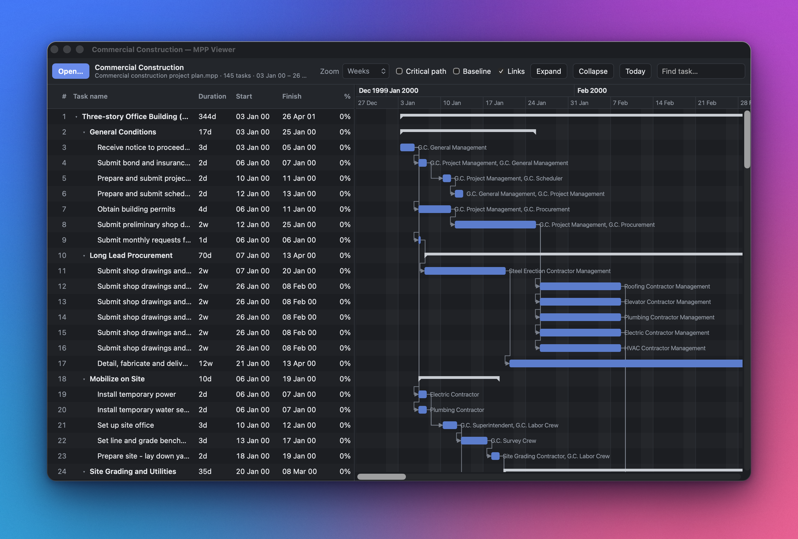

# MPP Viewer

A free, offline viewer for Microsoft Project files on macOS.

Open `.mpp`, `.mpt` or Project `.xml` files and browse the task list and Gantt chart. Everything runs on your Mac and nothing is uploaded.

## Install

1. Download `MPP-Viewer-<version>.dmg` from the [Releases page](../../releases).
2. Open it and drag **MPP Viewer** to Applications.

Requires an Apple Silicon Mac (M1 or later). The app is signed and notarised by Apple, so it opens without any extra steps.

> Versions before 0.1.2 weren't notarised. Run `xattr -dr com.apple.quarantine "/Applications/MPP Viewer.app"` once in Terminal to open them.

## Usage

Press <kbd>⌘O</kbd> to open a file, double-click a `.mpp` file in Finder, or drag one onto the window.

## Features

- Task grid with outline, duration, start, finish and % complete
- Gantt chart with day, week, month and quarter zoom
- Dependency arrows for all link types, with lag
- Critical path and baseline overlays
- Task details: resources, predecessors, successors and notes
- Search by task or resource name
- Light and dark mode
- Keyboard friendly: <kbd>⌘F</kbd> find, <kbd>↑</kbd>/<kbd>↓</kbd> move, <kbd>←</kbd>/<kbd>→</kbd> collapse and expand

## Limitations

- Read-only: you can view plans but not edit them.
- Password-protected `.mpp` files can't be opened.
- The app is about 100 MB because it bundles its own Java runtime.

## Contributing

Bug reports and pull requests are welcome. See [docs/development.md](docs/development.md) for how to build and run the app locally, and [docs/releasing.md](docs/releasing.md) for how releases are made.

## Acknowledgements

Reading `.mpp` files is done by [MPXJ](https://github.com/joniles/mpxj), licensed under the LGPL and bundled unmodified as separate jars. The app shell is built with [Tauri](https://tauri.app).
